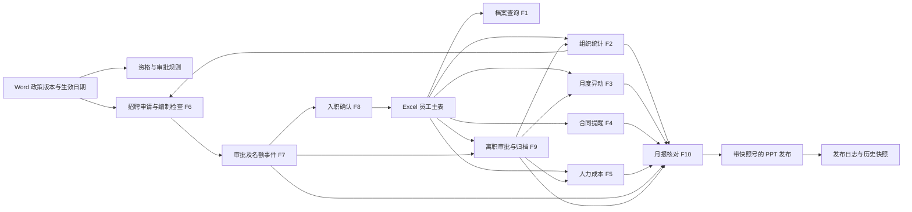

# 初始成熟 Office 业务系统设计

状态：供讨论的系统规格，尚未生成 Office 文件，也未运行 GPT-6.2-sol。

## 目标

以 Workspace-Bench Lite 38 员工信息管理工作簿为结构参考，设计一个在 M1 开始前已经运行的 HR 运营工作区。后续里程碑要求 Agent 改造已有流程并通过累积回归测试。这个设计用于决定如何构建自有 Benchmark，不把 Workspace-Bench 原文件当成最终任务资产。

Lite 38 样本有 14 张表，包含员工主表、档案查询、组织结构统计、月度异动、人力成本、生日提醒、离职档案、照片目录、简历信息和多个统计辅助表。实测确认学历统计会随主表输入变化。当前能说明该工作簿具有多个公式驱动的 HR 功能。它没有证明完整的人事审批事务、跨文件自动发布和历史快照都已实现，因此这些业务能力是新系统设计目标，不应描述成 Lite 38 已有能力。

## 工作区文件

| 文件 | 责任 | 持有状态 |
|---|---|---|
| `HR_Operations.xlsx` | 员工主数据、月度成本、申请队列、审批结果、名额、历史事件、派生统计及测试输入 | 唯一业务事实源。公式维护当前派生值，操作日志保存已发生事件 |
| `HR_Policy.docx` | 政策版本、资格定义、审批顺序、异常处理和文件维护规则 | 每个版本有生效日期。修改当前政策不得改写旧政策版本 |
| `HR_Operations.pptx` | 月度运营快照，展示编制、招聘、离职、成本、审批积压和服务指标 | 发布时从 Excel 的已发布快照复制数值。发布完成后为只读历史快照 |
| `hr_workflow.py` | 仅供初始系统生成和评分端使用的参考执行器、状态转换及测试驱动器 | 在 M1 前随系统交付，后续 Agent 任务允许编辑。此脚本不是模型外置 Oracle |

设计时以合成的员工 ID 和日期造数据。公开材料不含真实员工身份信息。Word 中的政策条款使用可核对的版本号和生效日期，PPT 页面印有报告期及快照号。Excel 保存相同快照号，用于对账。

## M1 开始前已经存在的业务功能

下表每项是可调用或可观察的业务行为，不按单元格或公式条数计算功能数量。基线系统须先通过右栏测试，再发布给 Agent。

| ID | 既有功能 | 输入 | 输出和更新 | 主要文件与依赖 |
|---|---|---|---|---|
| F1 | 员工档案查询 | 员工 ID、查询字段 | 返回主表中对应员工的档案视图 | Excel 员工主表 → 查询页 |
| F2 | 组织结构统计 | 当前员工表、统计月份 | 按部门、学历、岗位等级统计人数 | 主表 → 组织统计页与 PPT |
| F3 | 月度入离职统计 | 入职日、离职日、部门、统计月份 | 月度新增、离职、期末在职人数及流失率 | 主表＋离职档案 → 月报辅助页 → PPT |
| F4 | 合同到期提醒 | 合同到期日、固定运行日期、提醒窗口 | 到期员工队列和人数 | 员工主表 → 提醒页 → 首页/PPT 待办 |
| F5 | 人力成本汇总 | 月份、部门、工资、福利、招聘和培训成本 | 部门成本、总成本、环比 | 成本明细 → 汇总页 → PPT |
| F6 | 招聘申请登记与资格检查 | 部门、岗位、人数、预算、编制余额 | 待审批申请、资格理由、预占编制 | Excel 申请队列＋Word 政策 |
| F7 | 招聘审批及名额分配 | 已检查申请、部门名额、审批人、审批顺序 | 批准/拒绝结果和占用名额；审批事件写入日志 | F2 编制统计 → F6 → 审批队列 → 事件日志 |
| F8 | 入职确认 | 已批准且已签发的申请、入职日期、员工资料 | 创建员工主表记录，关闭招聘申请，更新编制与人数 | F7 → 员工主表 → F2/F3/F4/F5 |
| F9 | 离职申请、审批和归档 | 员工 ID、申请日、最后工作日、审批结论 | 批准后关闭在职记录、写入离职档案、记下当时部门和成本归属 | 主表 → 离职队列 → 归档 → F3/F2/F5 |
| F10 | 月报核对与发布 | 统计月份、Excel 结果、政策版本 | 生成编号快照、PPT 页面和发布日志 | F2–F5/F7/F9 → 对账检查 → PPT 快照 |

F1–F5 对应 Lite 38 中实际存在的查询、统计、提醒、成本功能。F6–F10 是围绕 HR 主数据设计的状态操作和正式发布功能，Lite 38 的样本并未验证这些完整流程。

## 数据及状态依赖

状态规则须在初始系统中预先实现并测试：申请可从 `draft → checked → pending → approved/rejected → issued` 转换；只有 `issued` 的招聘申请能触发入职；离职审批通过后才写入离职档案；发布快照只读，后续当前数据变化要创建新快照。审批与入离职历史不能由当前公式重新计算覆盖。

## M1 前的独立基线验收

基线 Oracle 用独立 Python 参考模型计算状态与预期值，不依赖 Excel 自身公式得分。Excel 在隔离的 LibreOffice Calc 中重算。Word 政策由版本及条款检查器核对。PPT 通过快照号、期次、关键指标和历史版本对账。参考执行器与评分器分开实现，并使用手算小样本交叉核对。

| 测试组 | 基线输入干预 | 必须观察的输出/保护条件 |
|---|---|---|
| T1 查询 | 查询两个合成员工 ID | 每个结果返回对应员工字段，不串行 |
| T2 组织统计 | 将一名员工的部门或学历改到另一类别 | 原类别人数减 1，新类别加 1，合计人数不变 |
| T3 入职统计 | 将一名新员工的入职日期跨到相邻月份 | 仅目标月份新增人数改变，其他月份不变 |
| T4 离职统计 | 将批准离职事件日期跨月 | 月度离职数和流失率按定义变化，档案事件仍唯一 |
| T5 合同提醒 | 固定基准日，令一份合同分别在窗口外、窗口内、当天到期 | 提醒状态按边界变化；更改测试日能改变提醒，输入日期不被覆盖 |
| T6 人力成本 | 将某月某部门工资增加 1,000 | 对应部门成本和总成本各增加 1,000，其他类别保持 |
| T7 招聘审批 | 对编制内、超编、预算超限申请执行检查与审批 | 状态、拒绝理由、名额占用符合政策，不重复占位 |
| T8 入职串联 | 从批准并签发的申请执行入职 | 创建一条员工记录，关闭申请，组织人数加 1，招聘占用转为实有人数，不双计 |
| T9 离职串联 | 对员工依次提交、批准离职 | 在职统计扣减，档案新增一条，原审批事件及部门快照保留 |
| T10 报告发布与回归 | 发布一期；修改当前数据；再发布二期 | 二期读到新数据；一期 PPT、快照号和日志不变；两期可分别对账 |
| T11 失败路径 | 拒绝/撤销待审批项，尝试对已归档记录重复执行操作 | 不产生入职、不重复释放名额、不改写历史快照 |

只有所有标作基线能力的测试都通过，才开始 M1 后续变更。每轮结束在 Agent 的最终 Office 文件和脚本上累积重跑 T1–T11 中仍适用的测试。新政策替代旧政策时，按版本日期分开测试，不能把旧版本规则当作当前回归错误。

## 后续里程碑怎样修改既有功能

本规格不预设最终任务轮数。建议第一轮需求选择一个真实的共用逻辑改动，例如增加生效日期的部门编制政策。任务应要求已有的招聘资格检查、名额分配、组织报表和月度发布都使用同一政策版本。它不应只要求 Agent 在工作簿旁边添一列结果。

后续需求可以扩展调岗与跨部门成本归属、合同续签资格及历史政策重算。每个需求都要改动至少一个既有入口，并保留既有查询、核准、归档和报告行为。是否存在真实旧功能回归，由预先冻结的基线测试判断。

## 与酒店原型相比，复杂度增加在哪里

| 维度 | 先前酒店原型 | 本规格的成熟 HR 基线 |
|---|---|---|
| 已有功能 | 少量审批、签发、退款和递补操作 | 10 类功能，含读取、统计、查询、审批、状态写入、归档与发布 |
| 共享数据 | 几家酒店、名额及申请状态 | 员工主表、部门编制、月度事件、成本、合同、离职档案和报告快照 |
| 修改影响 | 多数改动集中在一条审批链 | 一项政策变化可能同时影响申请入口、员工状态、汇总统计、归档和报告 |
| 跨格式职责 | 有报告输出，但连续系统以 Excel/Python 状态为主 | Excel 保存事实与运行状态，Word 保存规则，PPT 发布只读历史结果 |
| 回归范围 | 操作序列较少 | 每轮需要复测多个不同的旧行为及状态边界 |

这些是设计上的复杂度主张，不是实验结论。正式构建前应检查每条依赖能否被实际调用、阻断上游是否让下游失败、Office 文件保存/重载后状态是否仍正确。不能用功能数、公式数或测试条数替代这一验证。

## 需要讨论和冻结的决定

1. 初始系统是否选 HR 运营作为主要场景，还是要与财务/固定资产并行构造另一类成熟系统。
2. `hr_workflow.py` 是否作为 Agent 可编辑的系统组成部分交付，还是把所有操作逻辑放在可见 Excel 公式中。推荐交付脚本，因为审批状态、事件幂等和归档用公式难以真实实现。
3. 招聘名额采用部门编制、总预算还是两者共同约束，以及手工审批是否允许覆盖规则。
4. PPT 报告是系统正式发布行为还是只读输出。此设计将其设为发布产物，旧快照不可更改。
5. 首个 M1 后续需求应修改哪一段共享规则。建议从政策生效期及部门编制开始，并保留历史申请按旧政策核对的测试。

在这些决定冻结之前，本设计只作为成熟系统蓝图，不构成可运行 Benchmark。后续生成器仍需从合成事实构造 Office 文件、规则正文、运行接口、独立 Oracle、输入扰动和累积回归测试。
