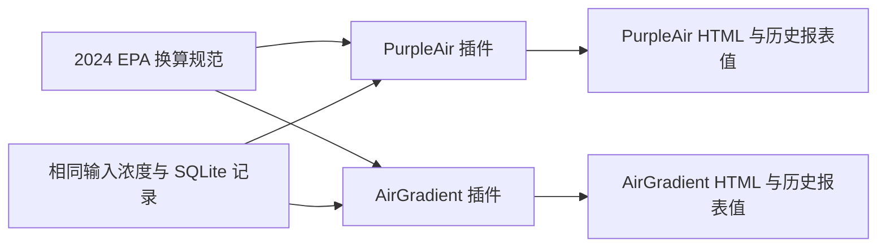

# PM2.5 AQI 的真实版本变更与报表维护对照

## 需求、版本和验收

1. **原始需求。** EPA 2024 年修订 PM2.5 的 AQI 断点。此次只复核危险区间的高端锚点。PM2.5 浓度 225.5 µg/m³ 对应 AQI 301，325.4 µg/m³ 对应 AQI 500。超过 500 继续沿该段外推。PurpleAir 在 2024 年公开确认会调整地图和设备的换算，2026 年 8 月确认地图已更新。现有公开记录尚不能还原一套共同部署的地图、设备固件和下游报表快照。[EPA 规则](https://www.govinfo.gov/content/pkg/FR-2024-03-06/pdf/2024-02637.pdf) · [2024 年产品工单](https://community.purpleair.com/t/updated-usepa-naaqs-for-pm2-5/8148) · [地图实施确认](https://community.purpleair.com/t/have-the-epa-pm2-5-breakpoints-changed/22858/2)
2. **实际版本。** 两套开源 WeeWX 插件把原有 `pm2_5` 浓度动态换算成报表指数。PurpleAir 插件由 `v4.1` 到 `v5.0`，AirGradient 插件由 `v1.1` 到 `v2.0`，均于 2026 年 7 月 18 日的新版修复了同一条高浓度换算。旧实现把 AQI 500 错误地锚在 425.4 µg/m³。对照固定到四个提交，读取真实插件源码、报表配置和 Cheetah HTML 模板。[PurpleAir 代码变更](https://github.com/chaunceygardiner/weewx-purple/compare/v4.1...v5.0) · [AirGradient 代码变更](https://github.com/chaunceygardiner/weewx-airgradient/compare/v1.1...v2.0) · [固定提交](manifest.json)
3. **独立验收。** 按 EPA 2024 年技术手册 Table 6 和公式重算 16 个输入。逐套插件检查 XType 的单条值、SQLite 历史聚合、实际 HTML 中的数值和颜色。两个新版的上游测试套件分别通过 97 项和 92 项。本地使用同一组输入重放两个真实版本的报表。历史数据通过试验用 SQLite 记录提供，归档其原始浓度以核对未被改写。[EPA 技术手册](https://nepis.epa.gov/Exe/ZyPURL.cgi?Dockey=P101AP0Q.TXT) · [重放程序](replay.py)

| 版本组合 | PurpleAir HTML 250 / 325.4 µg/m³ | AirGradient HTML 250 / 325.4 µg/m³ | 验收通过 |
|---|---:|---:|---:|
| 两套历史旧版 | 325 / 400 | 325 / 400 | 92/128 |
| 只更新 PurpleAir 的实验组合 | 350 / 500 | 325 / 400 | 110/128 |
| 两套历史新版 | 350 / 500 | 350 / 500 | 128/128 |

只更新一套插件时，18 条失败都落在 AirGradient 的高浓度数值路径。此前的浓度记录和危险区间颜色仍正确，所以报表只做颜色或文字检查时会漏检这项差异。

## 集中与分散的编辑对照

两种工作空间都由实验组装。**分散版**装入两套真实旧插件及其原始模板，保留各自的换算。**集中版**把两处危险区间表达式提取到一个共用函数。修改前，两版的 128 项观测逐项相同。两版收到逐字相同的任务和同一业务验收规则，用同样的输入与 WeeWX/SQLite/Cheetah 工具评分。任务说明点出两类站点和需要维护的行为，具体位置由 Agent 查找。分散版保留的代码来自两套真实插件，两者在同一离线任务中运行是实验构造。[题面与运行入口](pilot.py)

| 规则布局 | GPT‑6.2‑sol 独立会话 | 验收结果 |
|---|---:|---:|
| 集中版 | 2 | 128/128、128/128 |
| 分散版 | 2 | 128/128、128/128 |

分散版两次均修正两个插件的换算，集中版两次均修正共用函数。四次都通过固定输入下的报表重放。本例验证了跨集成漏改可以稳定检出，实际 Agent 提交中没有观察到分散版劣化。当前两套插件使用同一种报表运行时，变更集中在同一个数值参数。结论限于该案例和这四次试验。

本地保留四个上游版本、选定渲染输出、独立验收值、每次实际提交及工具轨迹。程序重放历史源文件和隔离 Agent 提交时均使用 WeeWX 5.2.0。[可核验归档](manifest.json)
